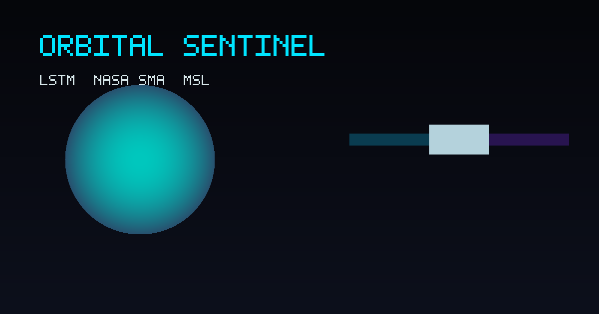
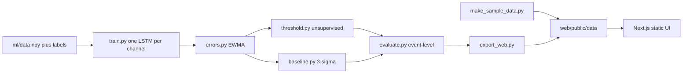

# ORBITAL SENTINEL

LSTM anomaly detection on NASA SMAP and Curiosity telemetry, with a static mission-control site. Training stays in `ml/`. The site in `web/` only reads JSON.



Live demo: `https://orbital-sentinel.vercel.app` (set the Vercel project root to `web/`).

## Results

The table below is copied from [`web/public/data/results.json`](web/public/data/results.json).

**SAMPLE DATA — not a trained model.** These numbers were produced by `ml/scripts/make_sample_data.py` so the interface can run before the NASA files are trained. The badge on the site disappears when a full `run_all` export sets `"is_sample": false`.

| Model | Precision | Recall | F1 | TP | FP | FN |
| --- | ---: | ---: | ---: | ---: | ---: | ---: |
| LSTM | 0.8171 | 0.6381 | 0.7166 | 67 | 15 | 38 |
| Baseline z-score | 1.0000 | 0.4762 | 0.6452 | 50 | 0 | 55 |

Sample contextual recall is 0.488 for the LSTM and 0.000 for the 3-sigma baseline. That gap is built into the synthetic series so the console can show a contextual miss the baseline never flags. It is not a measurement of the trained network.

Hundman et al. reported 87.5% precision and 80.0% recall in the NASA JPL paper. Those figures are not measurements from this repository.

### Measured partial run: P-1 only

`python -m scripts.run_all --only P-1` completed on this machine (CPU, seed 42, 32 epochs, best validation loss 0.0073). It did **not** replace the website JSON. From `ml/outputs/results.md`:

| Model | Precision | Recall | F1 | TP | FP | FN |
| --- | ---: | ---: | ---: | ---: | ---: | ---: |
| LSTM | 0.0000 | 0.0000 | 0.0000 | 0 | 1 | 3 |
| Baseline z-score | 0.0513 | 0.6667 | 0.0952 | 2 | 37 | 1 |

P-1's three labeled events are contextual. With these fixed hyperparameters the LSTM error stream barely separates them: the peak inside the first event is above the raw threshold and is then removed by the 13% prune, so the only surviving flag is a false positive. The z-score baseline overlaps two of the three events and raises 37 false alarms. LSTM recall did not beat the baseline on this channel. A full 82-channel run is the command above; it is not claimed here.

## Architecture



Vercel never installs PyTorch. Its root directory is `web/`.

## Reproduce

```bash
python -m venv .venv
.venv\Scripts\activate
pip install -r ml/requirements.txt
```

Download the NASA SMAP/MSL files into `ml/data/train`, `ml/data/test`, and `ml/data/labeled_anomalies.csv`. The original S3 zip used by telemanom currently returns 403. A public copy of the `.npy` files is the Hugging Face dataset `appleparan/telemanom` (`data/data/train`, `data/data/test`, and `labeled_anomalies.csv`). Kaggle `patrickfleith/nasa-anomaly-detection-dataset-smap-msl` is the same set if you have an API token.

```bash
cd ml
python -m pytest
python -m scripts.make_sample_data
python -m scripts.run_all --only P-1
python -m scripts.run_all
cd ../web
npm install
npm run dev
```

`run_all` without `--only` replaces `web/public/data` and writes `ml/outputs/results.md`. A partial run stays in `ml/outputs/` unless you pass `--publish`. Thresholds are not tuned on the labeled anomalies.

## Limitations

- Two missions only: SMAP and MSL.
- Labels come from expert anomaly reports.
- One model per channel, trained on that channel's nominal file.
- The threshold is unsupervised on the test error stream.
- Event-level overlap treats any overlap as a detection.
- The label file shipped with the public dataset lists `P-2` twice with two overlapping ranges. Scoring keeps both ranges on that one channel.

## Citation and license

Hundman, K., Constantinou, V., Laporte, C., Colwell, I., and Soderstrom, T. (2018). Detecting Spacecraft Anomalies Using LSTMs and Nonparametric Dynamic Thresholding. KDD.

Dataset credit: NASA JPL.

MIT License. See [LICENSE](LICENSE).
